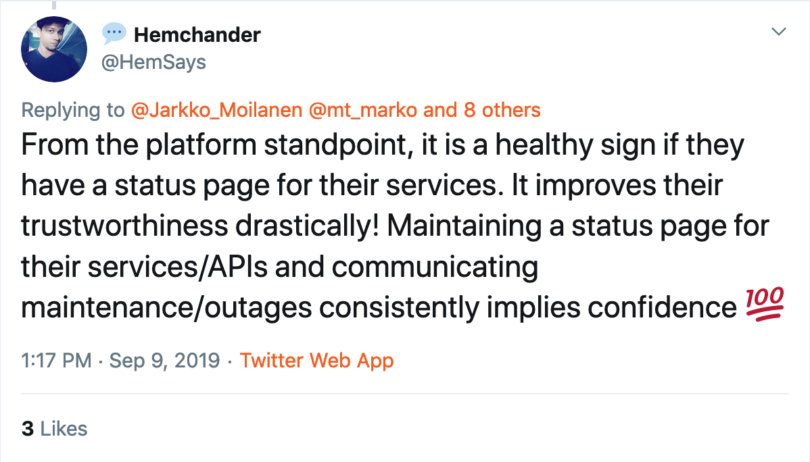

One of the elements of good API or platform is that primary customeers (developers) can see the status of your services as self-service. Statuspage.io is probably the most common approach. Status.io is pretty much the same. The above is most obvious answer if you ask someone of the purpose/reason why status page should be set up. But that's not all. Statuspage can have role in your Ops and sales process as well. 

## What the hell is status page? 

Some might not know that there are status page services (couple of mentioned above) and those are used intentionally from 3rd party. Implementing something like that your self is away from core development. The status page service are separated from target architecture and are more likely working better in case shit hits the fan. For example if part of your platform is under heavy DDoS attack, your status page is likely to be affected as well. But if it's outsourced it probably is accessible and showing weakened if not paralysed service capability.  

### Stay uptodate (subscribe)

Many of the status page services include subscription as well. Anyone can subscribe for updates and thus does not necessarily stalk the situation in the website. This is probably a good thing if you are heavily using or relying on some service. I'd rather integrate the updates to Slack so that our team can see the updates at the same time. I don't for example read my emails too often. Oh wait, statuspage.io at least offers [Slack integration](https://slack.com/apps/A0F7VRHCL-statuspage) :) 

### Common features

- Display the status of each part of your service
- communication as part of incident management 
- Showcase reliability
- Email/SMS/Webhook Notifications
- API to retrieve the current status.
- Integrations (Librato, New Relic, OpsGenie, PagerDuty, Pingdom, Pingometer, Twitter, Uptime Robot).
- Web interface which can be customized.
- subdomain for your status page. 

The integrations part is the "Zapier" nature of status pages. They have build-in integrations to plethora of systems many of which are system monitoring services. 

## Internal users

**Statuspges are useful for internal staff.** The current platforms are quite complex combinations of multiple services in the front and in the backend as well. Furthermore some components of the platforms are in-house driven and some are purchased as a service (often consumed via APIs). Then you really want to have visibility internally as well. Of course there are components you don't want to add in public status page. 

Your Operations team probably has more detailed and thorough view to the systems than external developers. As it was discussed above, the status services offer private views as well.  

**Sometimes it's hard to say is statuspage part of your DX or your Ops.** To me Ops is part of internal developer experience, but I do understand that there are different ways to see this. Nevertheless internal staff (Ops) has use cases for status page instead of looking at the situation from multiple consoles or subservices in dozen of URLs. 

To say that status page etc are more on the Ops side is a valid viewpoint since it's more commonly related to service monitoring which is a huge business and often complex settings. Statuspage.io and alike offer one entry point to aggregated data and results. Still the actual monitoring is done with other tools. 

**Your internal support team** most likely finds this useful as well. They don't need to worry ops or developers to see if all services are up and running when the customer might be complaining about service quality. Then the support can verify the situation and even advice the customer to use same service in the future. Thus reducing the contacts to support as well. And as we all know human support is not cheap. **Status page can reduce duplicate support tickets & emails.**

## External users

External users - the consumers - aka developers expect you to have a status page. Most common use case for them is not to go there to see that all is well and services run smoothly. They go there to see why or what kind shit hit the fan. Something is broken in their app. They are debugging the reason. 

## Can I rely on your status page? 

You should be able to rely on the information. The idea of status page is just brilliant. A service to check if there are problems with consuming the platform or API. As a developer you should be able to trust that the information given is accurate. In reality this appears not to be the situation. 

We can only guess the reasons why old or inaccurate information is visible in the status pages. At least couple of options can be thought of. 

First, **the process to update status is manual**. This was pointed out by Viljami. I was kind of WTF on this, but that is because I have "automate everything" hardwired n my thinking. Of course you might have some things manual in the beginning, but I can't see manual updates very feasible in the long run. That is boring and causes mistakes and delays. Delays in turn affect the developer experience. 

Secondly, it might be **measuring just one layer of the feature**. For example the APIs (facade) is working, but the backend behind it or part of it is down. Remember that services behind APIs are more commonly microservice architecture based. The broken chain effect. Considering that, should we have statuses for features/capabilities rather than sub/front services? It should test the whole process from bottom to top

Then again as [Viljami](https://twitter.com/anttiviljami/status/1170589431276945408) points out "_You should definitely have end to end monitoring for your core API/service features. Public statuses for each individual test case would in theory be cool and transparent, but if one core feature is down, it probably means the whole service is unusable anyways._" I agree with that. It seems that just throwing something to status indicators should NOT be your mode of operation. For the end-user (developer) it does not have much value if your fasade (public API) is up and running, but internal APIs are down. Your indicator for the mentioned public APIs must take into account the depencies, not just self. 

You should not use msde up tests to create uptime or performance statistics either. Build it on the actual usage. 

From consumer's point of view what matters is that does the function/feature work or not. If any part of the value chain behind the public API is failing, the public API is failing from consumer's pointof view. The public API might be a microservice and functioning itself perfectly. Red line in the below illustration is the borderline between public and internal. In the picture if anything on the right from the red line is broken or slow, then the public facing API is broken or slow. 

The above illustration does not fit when looking at it from internal perspective. Of course you want the public API to perform as well, but you are interested about the status of each component in the value chain. Or if you are in a team responsible just for the API management, then status of it is what interests you most. 

## Used in evaluation

Statuspages can be used in evaluating your API as well. The developer looks at your statuspage to see how reliable it is. That in turn affects the logic and complexity of the consuming app. One might go lighter with error checking (basic checking still there) if the API has proven to be reliable. 

Although past good record is a valid sales argument and indicates stability in your service, it is not something you can count on. Past is not the proof for future. 

## Dedicated view for customer segments

In our case the external developers are divided to two groups: application developers and data integration. They have somewhat different needs although both are interested about for example login and ACL services statuses. Otherwise the needs differ. Like in Developer portal where we reduce the "noise" from the developer personas by having dedicated landing pages for both to reduce irrelevant content, we might do the same in Status page. Data integrator is focused on the operations "under the hood" eg data flowing from the source to the platform. Application developer comes from the opposite direction and wants to see if for example our Broker API is alive and well.  

# Statuspages in 360 DX piechart

Based on the above status indicators (often status page) can be placed in multiple spots in the 360 DX pie. 

**Firstly it is part of your Ops** (internal) used in fast verification that our services are up and running. Your CIO probably wants to have this kind of view as well. 

Secondly, it's the service to look for if your app is having issues and developer suspects that it might be your API / platform causing the issues. It's **one of the debugging tools.** This is the obvious part status pages relate to DX. 

Thirdly, **it's part of your sales.** As it was discussed above customer wants to know of your APIs' reliability and that might even be the killer point of view. If your service reliability (awailability and related) can not be verified or it sucks, customer mostly likely considers to choose one of your competitors service. That is unless they are forced to use your service. 

Fourthly, it seems to be **part of marketing as well.** Display a history of reliability and performance with the uptime and response time graphs, as well as metrics. You can say that we have transparency in how we perform. Customer can verify the service level as self-service.  

Fifth, it's a **tool for your customer service.** They might have deeper wview to platform health than customers. That way your customer service knows of the possible problems and at the same time developers internally are aware (via notifications) about the issues. As a bonus you do not need to let customers to interact directly with your developers. They only distract and break the flow of the development. 